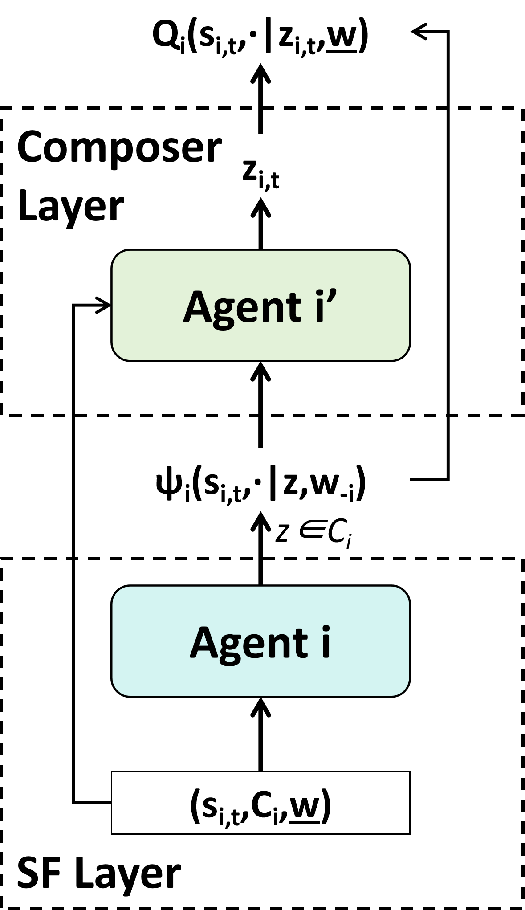

# MA-USFA

> **Current implementation (2026-11-17):** The repaired code uses frozen source actions, a task-conditioned vector-SF predictor and an attention-DDQN source-entry selector. Start with [REPRODUCING.md](REPRODUCING.md). The original release description below is retained as historical documentation; its commands, cached numbers and shipped SF checkpoint do not describe the current experiment pipeline.

**Paper:** "Is Per-Agent Policy Composition Safe? Rethinking Successor-Feature Transfer in Cooperative Multi-Agent Reinforcement Learning"(under review)



## The three composition rules

The experiments compare three ways of turning a shared, task-free successor
feature `ψ` into a policy for a new task weight `w`, plus a from-scratch
retraining baseline. Throughout the paper and this code they are named:

- **Independent** — each agent acts on its own greedy composition
  `a_i = argmax_a ψ_i(s_i, a)·w_i`, blind to its neighbours. Fully
  decentralized. This is the rule the paper shows can be unsafe under coupling.
- **Synchronized** — the team commits every step to one shared anchor drawn
  from a small source library, and every agent replays that anchor's per-agent
  greedy action. Shares a single integer (the anchor index), never a joint
  action, so it scales to hundreds of agents.
- **MA-USFA** — a learned neighbour composer: it warm-starts from Independent
  and adds a bounded, zero-initialized residual computed from a one-hop message
  pass over the interaction graph, so a node conditions on its immediate
  neighbours' tasks. This is the method that recovers safety where Independent
  cannot.

The retraining baseline trains a fresh multi-agent policy from scratch on the
target task and stands in for "the expensive thing composition is trying to
avoid."

## Repository layout

```
release/
  README.md              this file
  requirements.txt       Python dependencies (toy is numpy-only; TSC needs torch + SUMO)
  LICENSE                MIT
  toy/                   controlled grid world (numpy + matplotlib only)
    README.md            what each script shows and how to run it
    run_toy.py           free-region / gating / recovery pipeline
    run_crossover.py     the headline Independent<->Synchronized crossover
    run_extend.py        team-size and library-size sweeps
    make_figs.py         regenerate the three paper figures from cached JSON
    results/             cached result JSON + the paper PNGs
  tsc/                   Manhattan 28x7 traffic-signal-control experiment
    README.md            per-task run instructions for every rule
    train_sf.py          successor-feature pre-training + the three rules
    train.py             the retraining (IDDQN) baseline
    run_all.sh / .bat    full four-method matrix, both task families
    run_extended.sh / .bat  robustness sweeps (budget, library size, variance)
    checkpoints/         shared pre-trained successor features (sf_psi.pth)
    reference_results/   the exact result JSON behind the paper's tables
    data/                where the SUMO network files go (see data/README.md)
```

## Quick start

The toy is self-contained and reproduces the core claims in minutes on a CPU
with no external simulator:

```bash
pip install -r requirements.txt
cd toy
python run_crossover.py      # the Independent<->Synchronized safety crossover
python make_figs.py          # regenerate fig1/fig2/fig3 from cached results
```

The traffic-signal-control experiment additionally needs PyTorch and a working
SUMO / `sumo_rl` install plus the Manhattan network files (see
`tsc/data/README.md`). A pre-trained successor-feature checkpoint ships in
`tsc/checkpoints/` so you can run the three composition rules without repeating
the pre-training step:

```bash
cd tsc
./run_all.sh            # retraining / Independent / Synchronized / MA-USFA, homo + hetero
./run_extended.sh       # budget, library-size, and rollout-variance sweeps
```

See `toy/README.md` and `tsc/README.md` for the per-task commands.

## Citation

```

```


